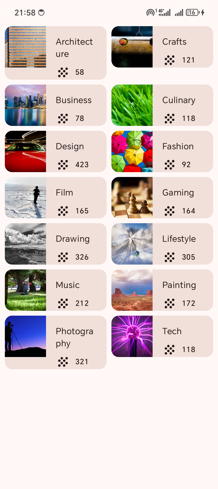

# Лабораторная работа №4. Создание списков

Абрамов Илья, ФИТ-241

| Задание | Проект | Что сделано |
|---|---|---|
| Практическая часть | `Affirmations` | Data-класс `Affirmation`, `Datasource`, карточки `AffirmationCard` в `LazyColumn` |
| Контрольное задание | `Courses` | Data-класс `Topic`, `DataSource`, карточки `TopicCard` в `LazyVerticalGrid` из двух столбцов |

## Запуск

Открыть папку нужного проекта в Android Studio, подключить телефон по USB с включённой отладкой и нажать Run.

## Скриншоты

| Affirmations | Affirmations (прокрутка) | Courses |
|---|---|---|
|  |  |  |
