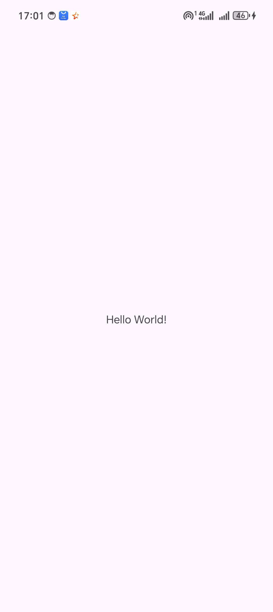
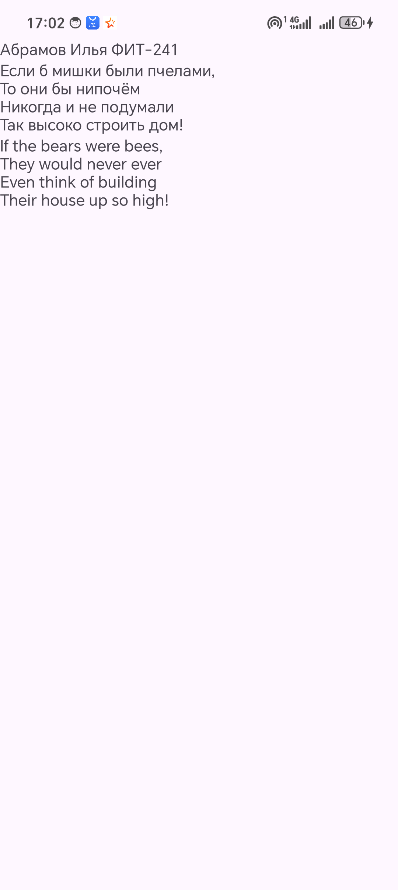
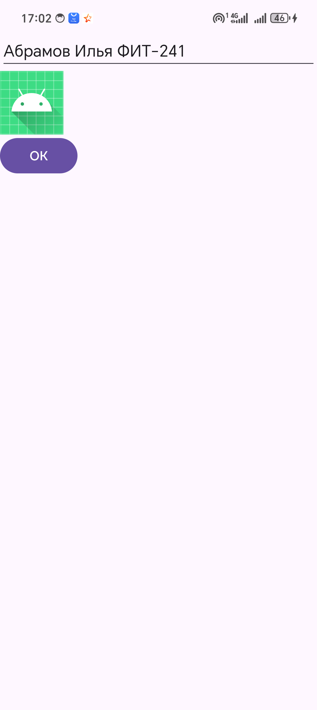

# Лабораторная работа №1. Знакомство с Android Studio

Абрамов Илья, ФИТ-241

| Задание | Проект | Что сделано |
|---|---|---|
| 1. Первое приложение | `FirstApp` | Шаблон Empty Views Activity, запуск на устройстве |
| 2. LinearLayout, TextView | `LinearLayout` | Вертикальный LinearLayout, три TextView, перевод стиха в `strings.xml` |
| 3. Button, ImageView, EditText | `Components` | EditText со строковым ресурсом, ImageView с иконкой, Button «ОК» |

## Запуск

Открыть папку нужного проекта в Android Studio, подключить телефон по USB с включённой отладкой и нажать Run.

## Скриншоты

| FirstApp | LinearLayout | Components |
|---|---|---|
|  |  |  |
