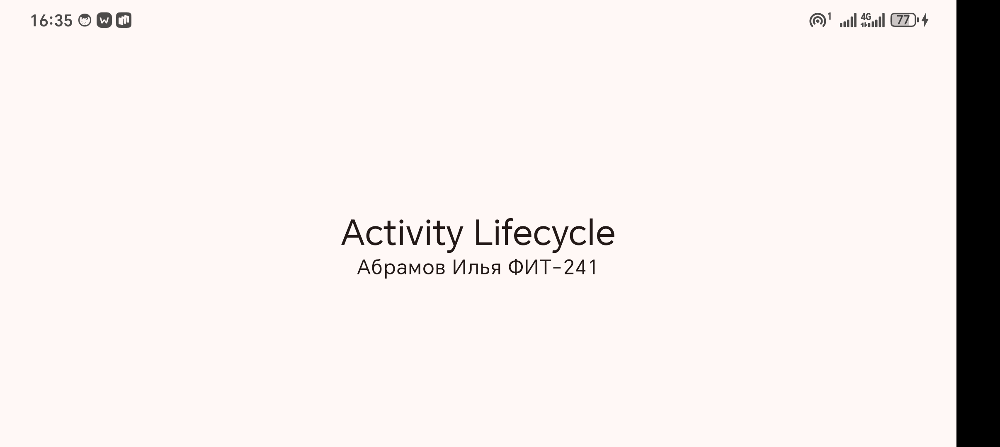
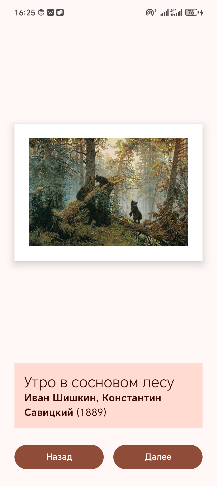
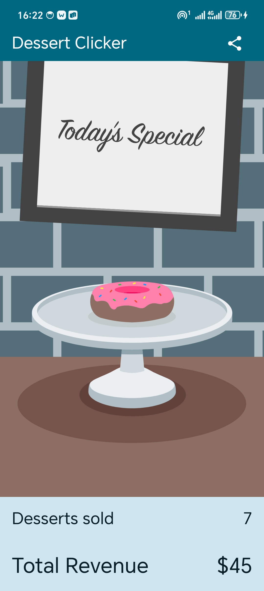
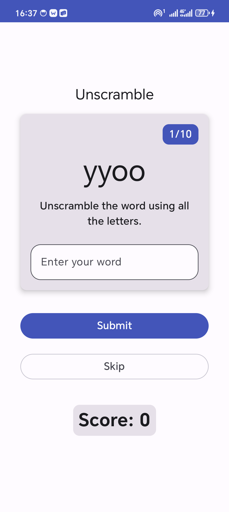
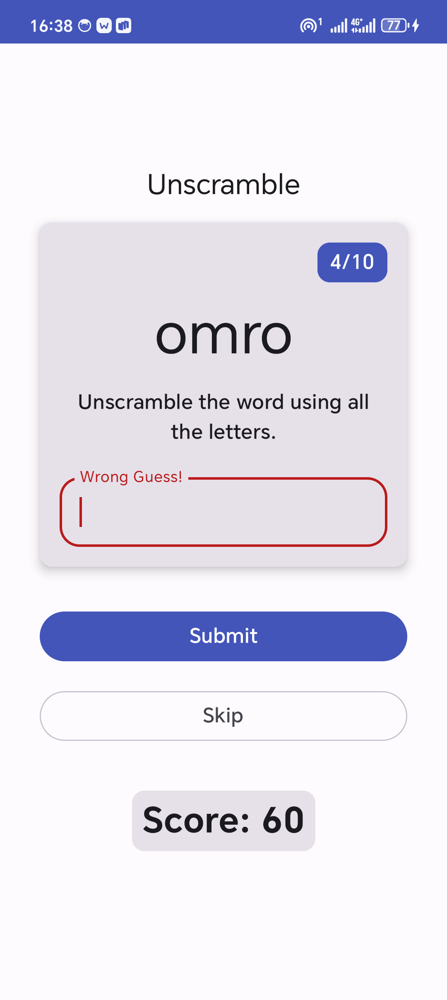
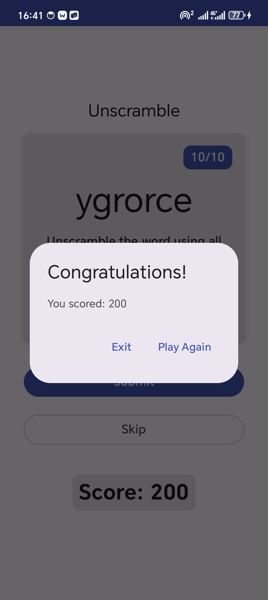
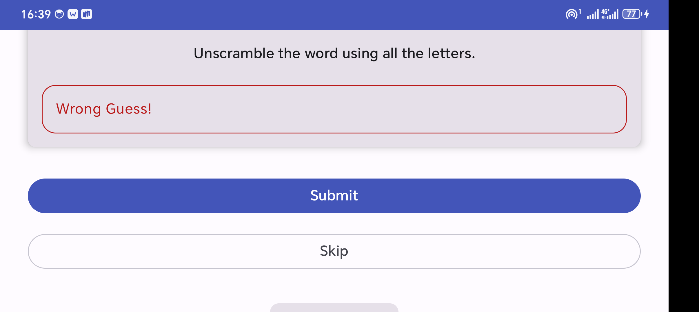
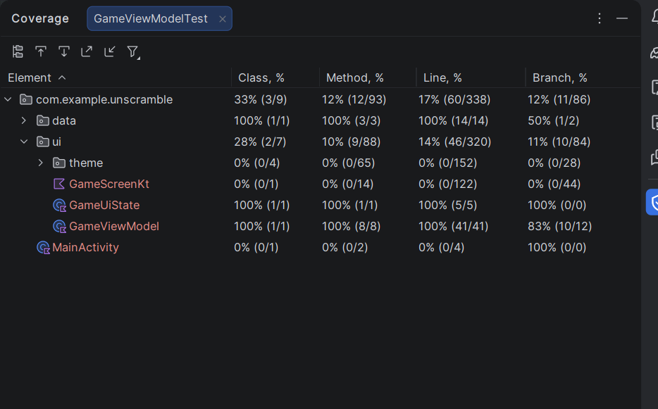

# Лабораторная работа №6. Жизненный цикл. Архитектурные компоненты

Абрамов Илья, ФИТ-241

| Задание | Проект | Что сделано |
|---|---|---|
| Контрольное задание 1 | `ActivityLifecycle` | Логирование всех методов жизненного цикла `MainActivity` (запуск, сворачивание, поворот экрана) |
| Контрольное задание 2 | `ArtSpace` | Приложение из лабораторной 5 переведено на `ArtSpaceViewModel` с `ArtSpaceUiState` и `StateFlow` |
| Контрольное задание 3 | `DessertClicker` | Состояние перенесено в `DessertUiState`, логика в `DessertViewModel` |
| Практическая часть и контрольное задание 4 | `Unscramble` | Игра на `GameViewModel` с `StateFlow`, unit-тесты `GameViewModelTest` (путь успеха, путь ошибки, граничные случаи) |

## Запуск

Открыть папку нужного проекта в Android Studio, подключить телефон по USB с включённой отладкой и нажать Run.

Тесты Unscramble:

```
gradlew testDebugUnitTest
```

## Скриншоты

| Activity Lifecycle | Activity Lifecycle (поворот) |
|---|---|
|  |  |

| Art Space | Dessert Clicker |
|---|---|
|  |  |

| Unscramble | Unscramble (неверный ответ) | Unscramble (конец игры) |
|---|---|---|
|  |  |  |

| Unscramble (после поворота) |
|---|
|  |

| Покрытие тестами |
|---|
|  |
