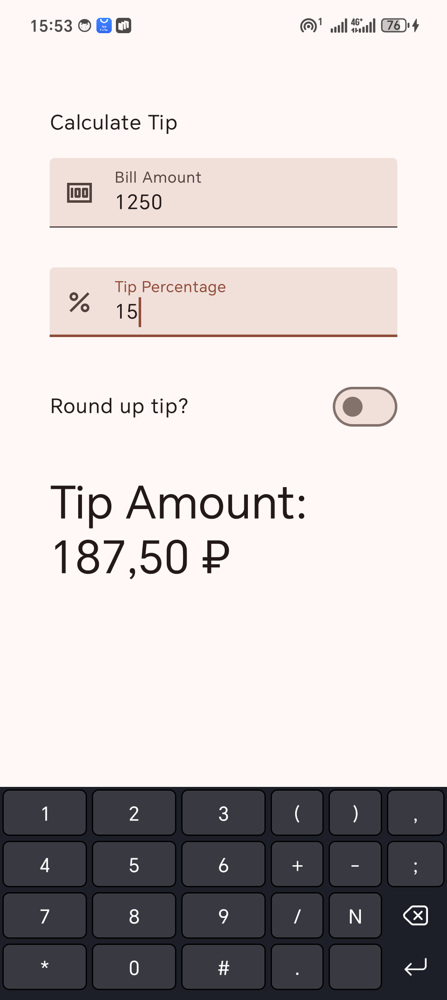
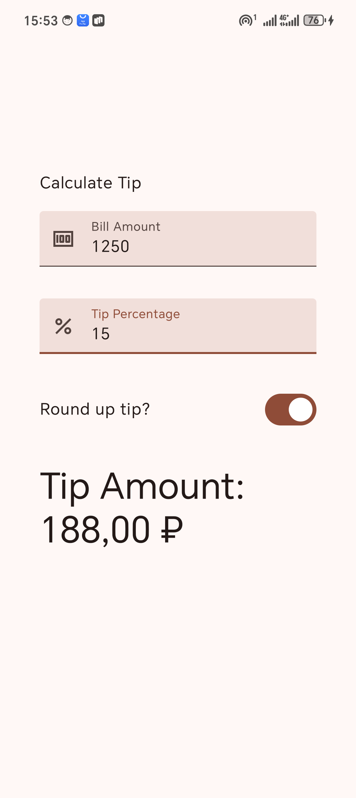
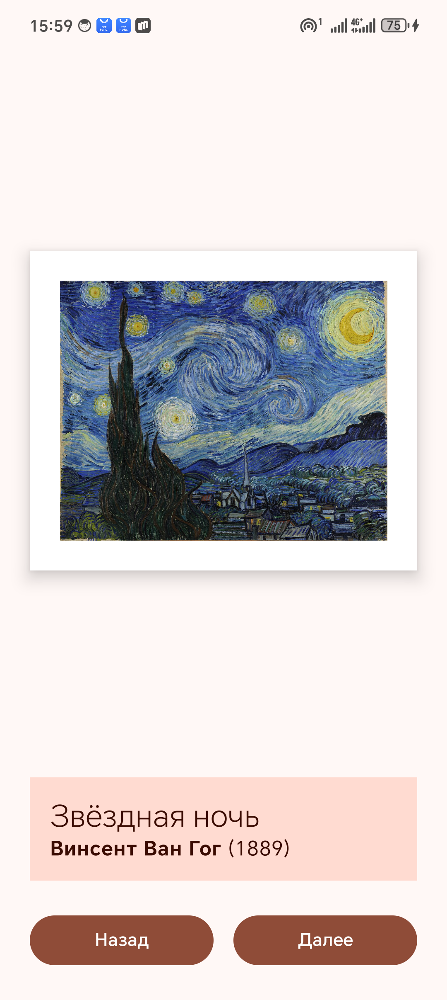
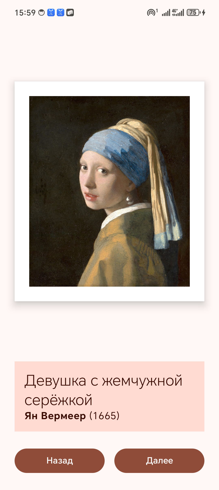
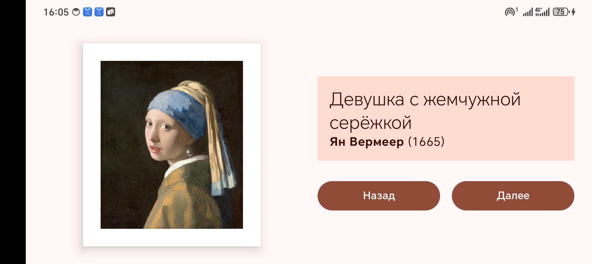

# Лабораторная работа №5. Взаимодействие с UI и состоянием. Тесты

Абрамов Илья, ФИТ-241

| Задание | Проект | Что сделано |
|---|---|---|
| Практическая часть и контрольное задание 1 | `TipTime` | Поля суммы счёта и процента чаевых (`KeyboardType.Number`, `ImeAction.Next` / `Done`), переключатель округления, поднятие состояния в `TipTimeLayout`, unit-тесты `TipCalculatorTests` и UI-тест `TipUITests` |
| Контрольное задание 2 | `ArtSpace` | Галерея из пяти картин с кнопками «Назад» и «Далее», выбор картины через `when`, отдельная вёрстка для широкого экрана |

## Запуск

Открыть папку нужного проекта в Android Studio, подключить телефон по USB с включённой отладкой и нажать Run.

Тесты TipTime:

```
gradlew testDebugUnitTest
gradlew connectedDebugAndroidTest
```

## Скриншоты

| Tip Time | Tip Time (округление) |
|---|---|
|  |  |

| Art Space | Art Space (другая картина) |
|---|---|
|  |  |

| Art Space (широкий экран) |
|---|
|  |
