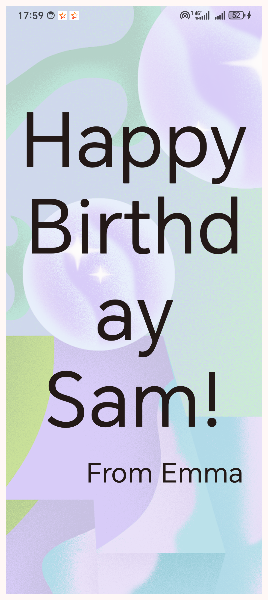
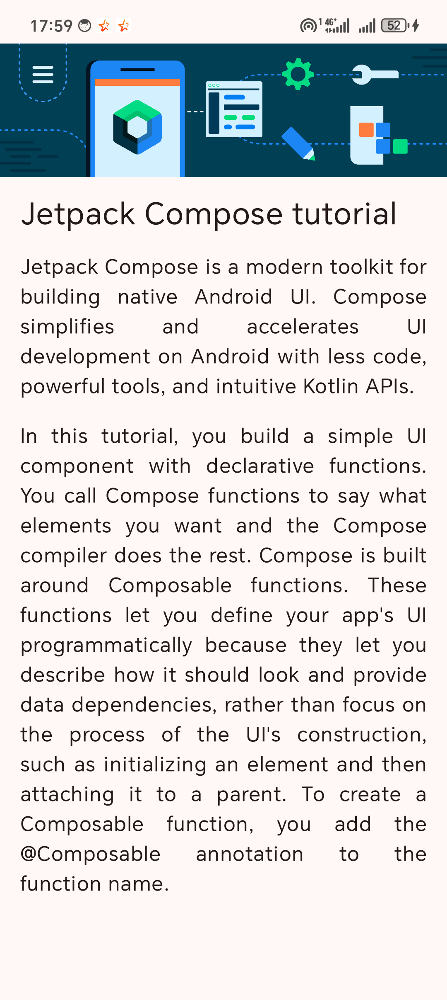
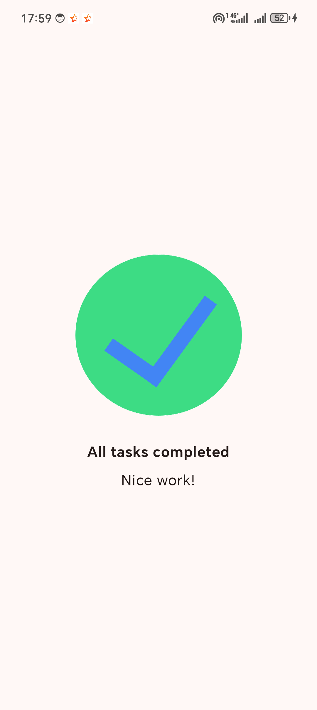
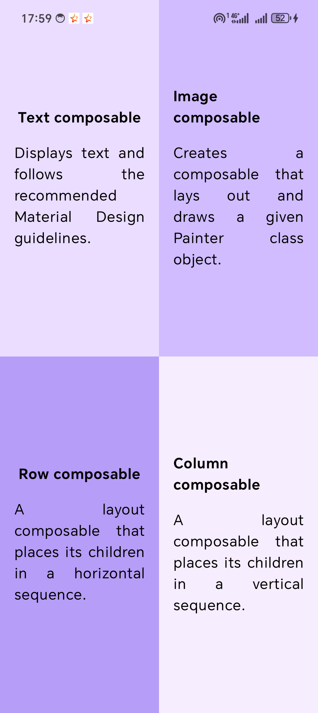
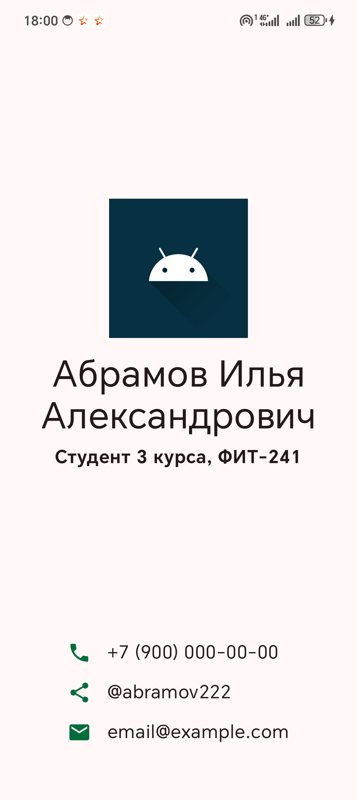

# Лабораторная работа №3. Начало работы с Jetpack Compose

Абрамов Илья, ФИТ-241

| Задание | Проект | Что сделано |
|---|---|---|
| Практическая часть | `HappyBirthday` | `GreetingText` и `GreetingImage`: Column, Box, Image с `ContentScale.Crop` и `alpha`, строки через `stringResource` |
| 1. Compose Article | `ComposeArticle` | Шапка-изображение, заголовок 24sp, абзацы с `TextAlign.Justify` |
| 2. Task Manager | `TaskManager` | Контент по центру, жирный заголовок с отступами 24/8dp, подпись 16sp |
| 3. Compose Quadrant | `ComposeQuadrant` | Четыре цветных квадранта через `Row`/`Column` и `Modifier.weight(1f)` |
| 4. My Information | `MyInformation` | Карточка с именем, группой и контактами с иконками |

## Запуск

Открыть папку нужного проекта в Android Studio, подключить телефон по USB с включённой отладкой и нажать Run.

## Скриншоты

| Happy Birthday | Compose Article | Task Manager | Compose Quadrant | My Information |
|---|---|---|---|---|
|  |  |  |  |  |
