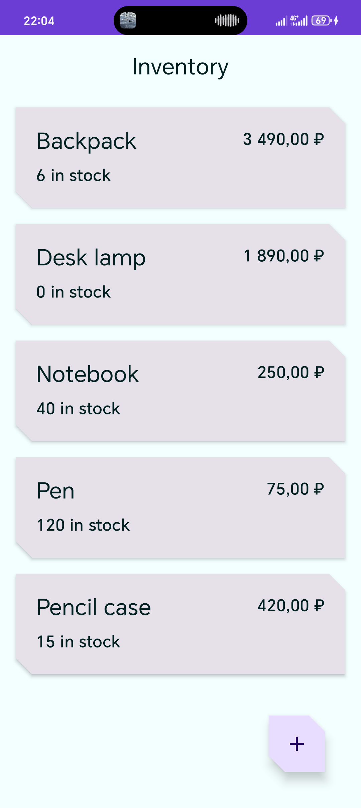
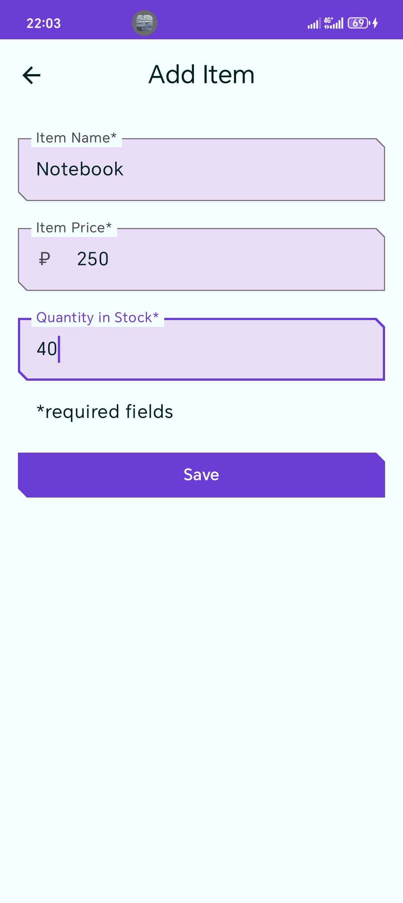
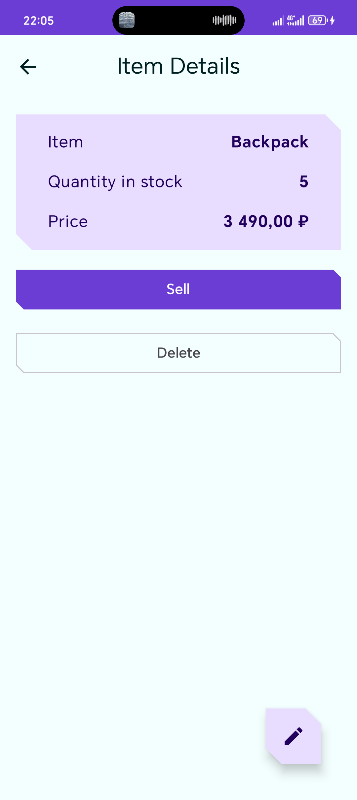
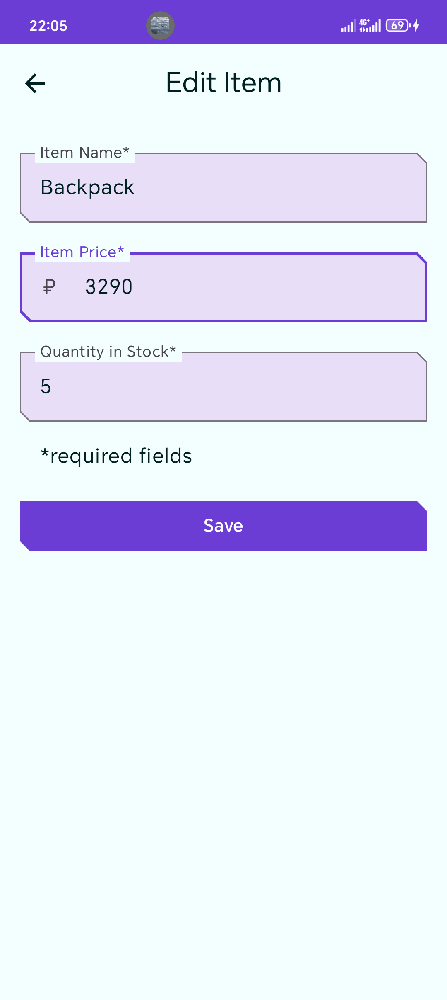
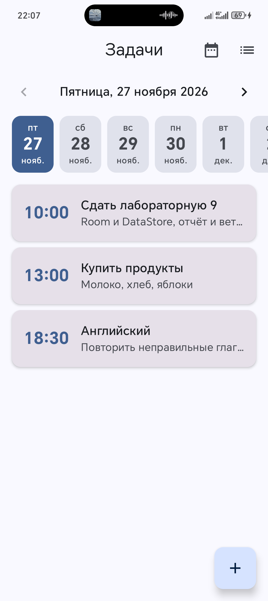
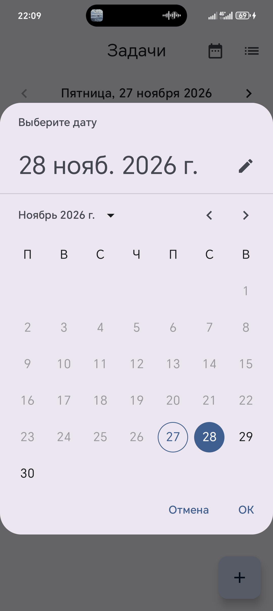
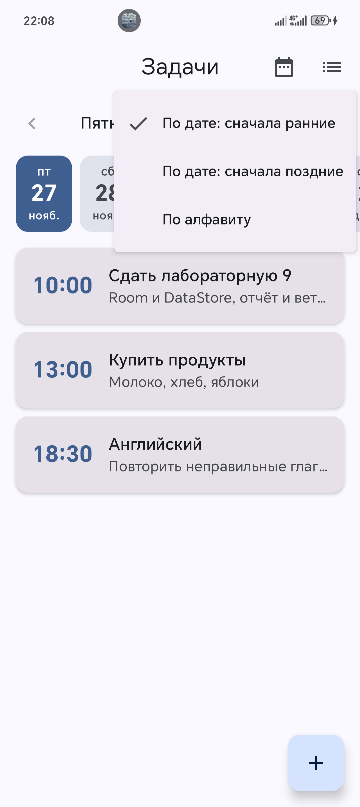
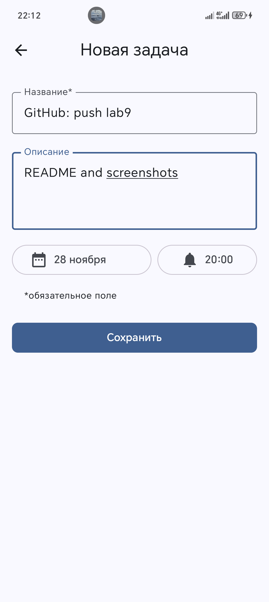
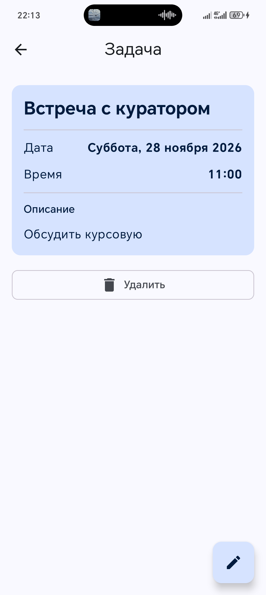

# Лабораторная работа №9. Кэширование данных. Room. DataStore

Абрамов Илья, ФИТ-241

| Задание | Проект | Что сделано |
|---|---|---|
| Практическая часть | `InventoryApp` | В стартовое приложение Inventory добавлен слой базы данных на Room: сущность `Item`, `ItemDao`, `InventoryDatabase`, репозиторий `OfflineItemsRepository` и `AppDataContainer`. ViewModel всех экранов работают через репозиторий: добавление, просмотр, продажа, редактирование и удаление товаров. Инструментальные тесты `ItemDaoTest` |
| Контрольное задание | `Tasks` | Приложение задач на выбранную дату: лента дат вперёд от сегодняшней, выбор даты в календаре, создание, просмотр, редактирование и удаление задач, сортировка по дате (по возрастанию и убыванию) и по алфавиту. Задачи хранятся в Room, последняя выбранная дата и сортировка — в Preferences DataStore, экземпляр DataStore передаётся в `OfflineTasksRepository` через конструктор. Тесты `TaskDaoTest` и `SortOrderTest` |

## Запуск

Открыть папку нужного проекта в Android Studio, подключить телефон по USB с включённой отладкой и нажать Run.

Unit-тесты сортировки Tasks:

```
gradlew testDebugUnitTest
```

Инструментальные тесты DAO (нужен подключённый телефон или эмулятор):

```
gradlew connectedDebugAndroidTest
```

## Скриншоты

| Inventory: список | Inventory: добавление | Inventory: товар |
|---|---|---|
|  |  |  |

| Inventory: редактирование | Tasks: главный экран | Tasks: календарь |
|---|---|---|
|  |  |  |

| Tasks: сортировка | Tasks: новая задача | Tasks: детали задачи |
|---|---|---|
|  |  |  |
