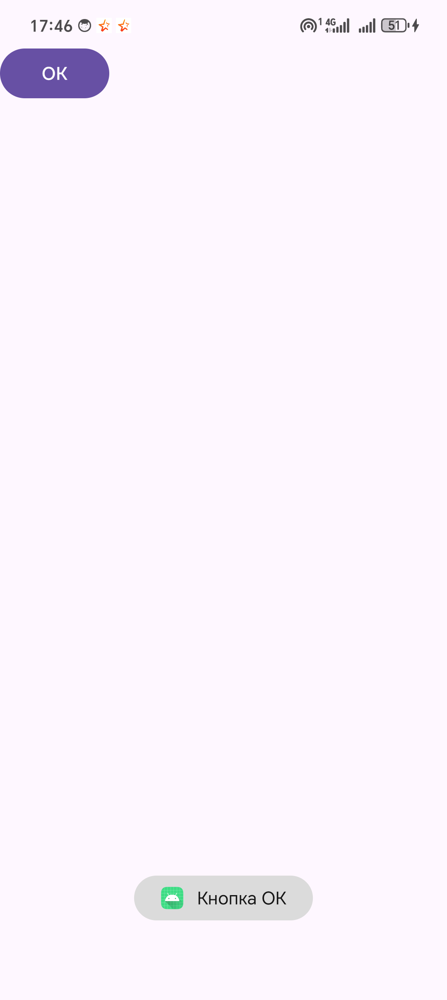
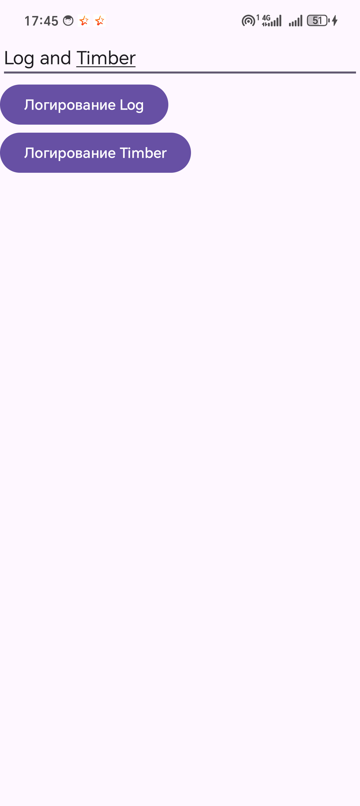
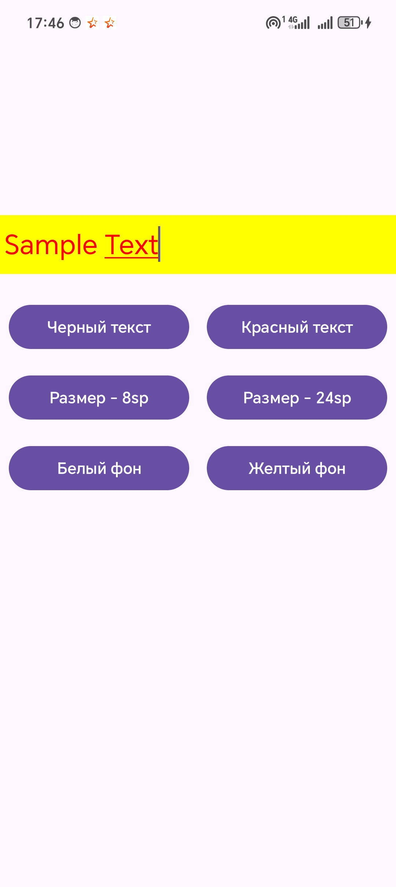
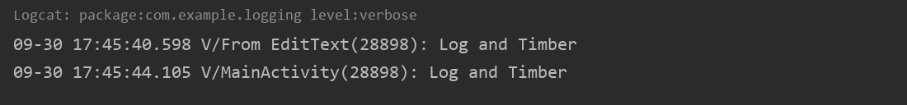

# Лабораторная работа №2. События в приложении

Абрамов Илья, ФИТ-241

| Задание | Проект | Что сделано |
|---|---|---|
| 1. Приложение с событиями | `ToastHandler` | Кнопка `button_ok` с `OnClickListener`, показывает Toast «Кнопка ОК» |
| 2. Логирование через Log и Timber | `Logging` | Verbose-сообщения из EditText через `Log.v("From EditText", …)` и `Timber.v(…)` |
| 3. Атрибуты background, textColor, textSize | `Attributes` | Шесть кнопок меняют цвет текста, размер и фон EditText |

## Запуск

Открыть папку нужного проекта в Android Studio, подключить телефон по USB с включённой отладкой и нажать Run. Сообщения логов смотреть во вкладке Logcat.

## Скриншоты

| ToastHandler | Logging | Attributes |
|---|---|---|
|  |  |  |

